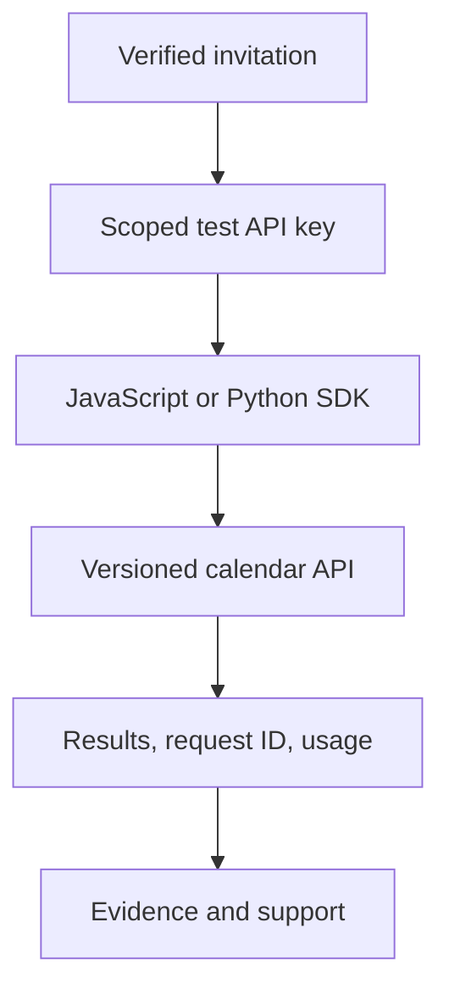

<h1 dir="rtl" lang="fa">تقویم.dev — SDK رسمی توسعه‌دهندگان (نسخهٔ آزمایشی)</h1>

<p dir="rtl" lang="fa">کتابخانه‌های آزاد JavaScript و Python برای کار با API تقویم.dev. این مخزن مستقل، عمومی و تحت مجوز Apache-2.0 است. ثبت درخواست در فهرست انتظار <strong>به‌معنای فعال‌شدن حساب یا دریافت خودکار کلید نیست</strong>.</p>

**Status: early-access preview, not a published npm/PyPI release or production certification.**

## Quickstart — JavaScript

Requires Node.js 20 or a compatible runtime. A test key must first be issued to your account.

```js
import {createTestClient} from "./javascript/index.js";
const client = createTestClient({apiKey: process.env.TAGHVIM_TEST_API_KEY});
const {data, requestId, rateLimit} = await client.convertDate({date:"1405-07-15"});
console.log({data, requestId, rateLimit});
```

## Quickstart — Python

```python
from taghvim_sdk import TaghvimClient
import os
client = TaghvimClient(api_key=os.environ["TAGHVIM_TEST_API_KEY"])
print(client.convert_date("1405-07-15"))
```

Python source is in `python/taghvim_sdk`; until a reviewed package release, install from a checked-out copy. Do not claim a package is published.

## Developer resources

- [JavaScript SDK](javascript/index.js), [types](javascript/index.d.ts) and [tests](javascript/test/client.test.mjs)
- [Python SDK](python/taghvim_sdk/__init__.py) and [tests](python/tests/test_client.py)
- [Supported operation index](contracts/operation-index.json) — OpenAPI `2.1.0`, source blob `c0d163f8e2d883125fc3778b17842bd19fe3f6bf`
- [Cookbook repository](https://github.com/Taghvim-dev/cookbooks)
- [Release evidence and contract synchronization](docs/RELEASE-GATES.md)
- [Product and early access](https://taghvim.dev/)



**Security:** keep all keys server-side; do not ship them in browser bundles. Test and live credentials are distinct. See [SECURITY.md](SECURITY.md). Contributions follow [CONTRIBUTING.md](CONTRIBUTING.md).

**License:** Apache-2.0 for original SDK code, examples and documentation; `NOTICE` and third-party licence terms apply. Trademark rights reserved.
