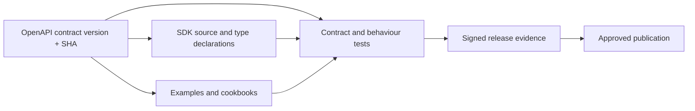

# Public SDK release and synchronization gates

Status: **preview; approval required before tagged release or package publication**.

The API contract is authoritative, not example snippets or auto-generated text. `contracts/operation-index.json` records the exact source contract blob SHA, version, source commit and accessible operation identifiers. Every SDK and Cookbook candidate must validate against it.

## Machine-readable traceability

## Gate sequence

1. Confirm approved API contract source revision and checksum; generate SDK/operation index using a locked generator configuration and deterministic output.
2. Unit tests (Node and Python), lint, secret scan, licence/NOTICE, docs and bidi lint; ensure no admin route is exported.
3. Compare **deployed** API version and SDK operation behavior; test against real isolated test credentials owned by a developer.
4. Confirm API key lifecycle, quotas, request ID, problem details, idempotency, per-tenant isolation, and at least one end-to-end Cookbook.
5. Review changes by an owner, record commit/CI/deploy/rollback evidence, and publish only a version explicitly approved for distribution.

## Continuous reconciliation

A merged API contract change should open a public-docs SDK synchronization proposal and CI should block cross-repo drift. Conversely, a public SDK change must receive a contract compatibility test back against Engine and Landing before tagged release. The current connection cannot install organizational webhooks or deploy a new shared pipeline; **this step remains a release blocker**, not an achieved guarantee.

## Licensing

Code/examples in this public repository are Apache-2.0. Trade names and logos are separate. No private engine sources, credentials, infrastructure provider details or subprocessor identities may be released.
